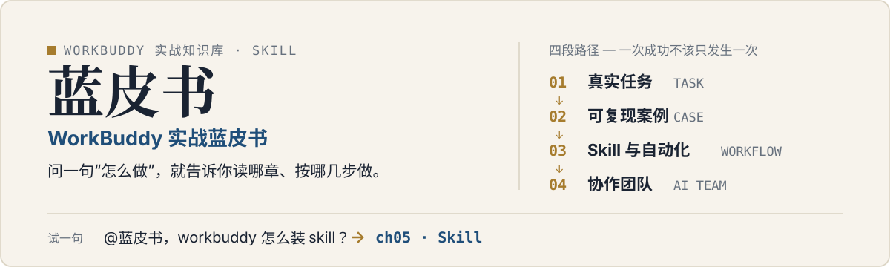

<p align="center">
  
</p>

# lhg-wb-bluebook · WorkBuddy 实战蓝皮书

可安装的 WorkBuddy 知识库 skill。装好后在 WorkBuddy 里 `@蓝皮书` 问一句“怎么做”，它按查询路由定位到对应章节，读完全文再按“目标 → 操作 → 验收”给可执行的步骤和能直接抄的指令模板。（SKILL.md v1.1.0）

## 它是什么

- **WorkBuddy 是腾讯的全场景职场 AI 智能体工作台，定位不是“回答问题”，而是交付结果**：你一句话说清目标，它自主规划步骤、操作电脑、产出文件（批量处理文档、表格分析、PPT 生成、行业调研、知识库构建等），人只负责验收返工。
- **本 skill 是 WorkBuddy 做法的查询入口，而不是 WorkBuddy 本体的替代文档。** `SKILL.md` 只放核心心法与查询路由，具体做法全部在 `references/` 的章节全文里。
- 三句核心心法（全书地基）：
  1. **Skill 是扩展 WorkBuddy 的方式**：WorkBuddy 本体负责理解任务和编排执行；Skill 是一组可复用的说明 + 脚本 + 参考资料，告诉它某类任务怎么做、调什么工具、交付什么格式。
  2. **四段路径**：真实任务（TASK）→ 复盘成可复现案例（CASE）→ 沉淀 Skill 与自动化（WORKFLOW）→ 组合成协作团队（AI TEAM）。一次成功不该只发生一次。
  3. **知识精馏**：把书 / 视频按“框架 / 原则 / 案例 / 反例 / 术语”五个维度提纯成可执行的 Skill，解决“学了用不上”——Skill 就是给 AI 装上触发器，让它知道何时调哪个框架。

## 先试一句

| 你问 | 它读 | 你拿到 |
|---|---|---|
| @蓝皮书，workbuddy 怎么装 skill？ | ch05（Skill） | ch05 的 Skill 标准结构，不自创安装路径 |
| @蓝皮书，我想让它每天早上给我发资讯汇总 | ch15（资讯整合）+ ch10（自动化任务） | 跨章两章都读，答案含定时设置做法 |
| @蓝皮书，有没有现成的指令模板？ | 附录 A | 直接给可复制模板，不复述概念 |

## 安装

```bash
npx skills add lhg-skills/lhg-wb-bluebook
```

- 或 `git clone https://github.com/lhg-skills/lhg-wb-bluebook.git` 后，把整个目录放进对应平台的 skills 目录
- 或在 SkillHub 中添加本仓库（`lhg-skills/lhg-wb-bluebook`）

装好后就问一句试试：`@蓝皮书，workbuddy 怎么装 skill？`

## 章节地图

下表就是 `SKILL.md` 里的查询路由原表，按使用场景分组；点文件名直达全文。共 28 章正文（书的第 1–28 章）+ 2 个附录，另有 `ch00` 课外阅读单列在最后。

### 入门

| 你想问 | 读 |
|---|---|
| WorkBuddy 是什么、能干嘛 | [ch01-初识.md](references/ch01-初识.md) |
| 怎么下载 / 安装 / 登录 / 更新 | [ch02-下载安装.md](references/ch02-下载安装.md) |
| 主界面、任务、工作区怎么用 | [ch03-主界面.md](references/ch03-主界面.md) |
| 第一个任务怎么做 | [ch04-第一个任务.md](references/ch04-第一个任务.md) |

### 核心机制

| 你想问 | 读 |
|---|---|
| Skill 是什么、怎么装 Skill | [ch05-Skill.md](references/ch05-Skill.md) |
| 专家 / 专家团 | [ch06-专家团.md](references/ch06-专家团.md) |
| 连接器 / MCP / 接入外部工具 | [ch07-连接器.md](references/ch07-连接器.md) |

### 实战接入

| 你想问 | 读 |
|---|---|
| 飞书办公实战 | [ch08a-飞书实战.md](references/ch08a-飞书实战.md) |
| 小程序 / IM 助理接入 | [ch08b-小程序IM.md](references/ch08b-小程序IM.md) |
| 接外部 API | [ch09-外部API.md](references/ch09-外部API.md) |

### 自动化与办公

| 你想问 | 读 |
|---|---|
| 自动化任务 / 定时任务 | [ch10-自动化任务.md](references/ch10-自动化任务.md) |
| Word / Excel / PPT 办公三件套 | [ch11-办公三件套.md](references/ch11-办公三件套.md) |
| 整理文件、批量处理 | [ch12-整理文件.md](references/ch12-整理文件.md) |
| 远程控制电脑 | [ch13-远程控制.md](references/ch13-远程控制.md) |

### 生活、信息与会议

| 你想问 | 读 |
|---|---|
| 生活助手、琐事自动化 | [ch14-生活助手.md](references/ch14-生活助手.md) |
| 资讯整合、每日通知 | [ch15-资讯整合.md](references/ch15-资讯整合.md) |
| 知识管理、收藏夹盘活 | [ch16-知识管理.md](references/ch16-知识管理.md) |
| 会议纪要、会后跟进 | [ch17-会议.md](references/ch17-会议.md) |

### 进阶：从单点到团队

| 你想问 | 读 |
|---|---|
| 投资分析 | [ch18-投资分析.md](references/ch18-投资分析.md) |
| AI 视频团队（一句话出视频） | [ch19-AI视频团队.md](references/ch19-AI视频团队.md) |
| 自媒体增长闭环 | [ch20-自媒体增长.md](references/ch20-自媒体增长.md) |
| GEO / AI 搜索优化 | [ch21-GEO专家.md](references/ch21-GEO专家.md) |
| 把书 / 视频蒸馏成自己的 Skill | [ch22-打造skill.md](references/ch22-打造skill.md) |
| 更多实操案例 | [ch23-实操案例集.md](references/ch23-实操案例集.md) |
| 多 Agent 系统设计 | [ch24-多Agent设计.md](references/ch24-多Agent设计.md) |
| 自动化工作流可靠性 | [ch25-工作流可靠性.md](references/ch25-工作流可靠性.md) |

### 路线图

| 你想问 | 读 |
|---|---|
| 不同岗位怎么用深 | [ch26-岗位路线图.md](references/ch26-岗位路线图.md) |
| 行业工作流 | [ch27-行业路线图.md](references/ch27-行业路线图.md) |

### 附录

| 你想问 | 读 |
|---|---|
| 常用指令模板（直接抄） | [appendix-A-指令模板.md](references/appendix-A-指令模板.md) |
| 场景速查表 | [appendix-B-场景速查.md](references/appendix-B-场景速查.md) |

> 另有 [ch00-课外阅读.md](references/ch00-课外阅读.md)《一章看懂 AI 工作系统》（全景图：用户目标 → Agent 规划 → Skill / 工具 / MCP → 验收 → 产物），不在查询路由表里，适合先读建立全景。

## 它怎么回答你

- **先读章节全文再回答**，不凭印象编功能路径；书里没写的就直说“书里没写”。
- 步骤按“目标 → 操作 → 验收”，每步可验收；能抄附录 A 的现成模板就直接给，改参数即可。
- 菜单位置、按钮名这类易变细节会标注“书里是这么写的，当前版本请核对”——WorkBuddy 版本迭代快。
- 回复一律中文；引用了哪一章、安装 / 制作引用 ch05 / ch22 的标准结构，都会标出处。
- 仓库内有 [references/smoke-test.md](references/smoke-test.md)（6 条路由测试 R1–R6 + 质量门），怀疑 skill 自身有缺陷时按它自检。

## 来源与归属

内容源自 [AlephAITech/WorkBuddyGuide](https://github.com/AlephAITech/WorkBuddyGuide)（MIT 协议），归档于 2026-10-19，按 skill 查询场景重新组织。对外引用请注明原出处。

本仓库目前没有单独的 LICENSE 文件；内容源遵循上游 MIT 协议。Gitee 镜像同名。

---

## 出品：刘洪光

本 skill 由真人出镜 IP「刘洪光」（安徽合肥）出品，归属 [lhg-skills](https://github.com/lhg-skills)。

- GitHub 主页：https://github.com/lhg-skills —— 全部 skill 开源在此，欢迎 star
- 抖音：搜「刘老师讲AI实战」
- 微信：lhgsmsw

觉得有用，欢迎点 ⭐ Star。
